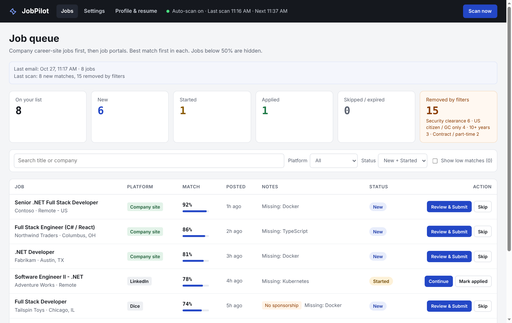
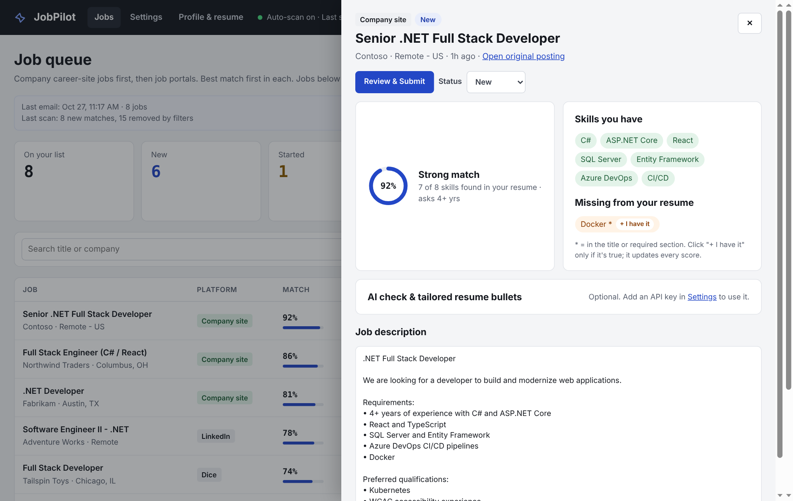
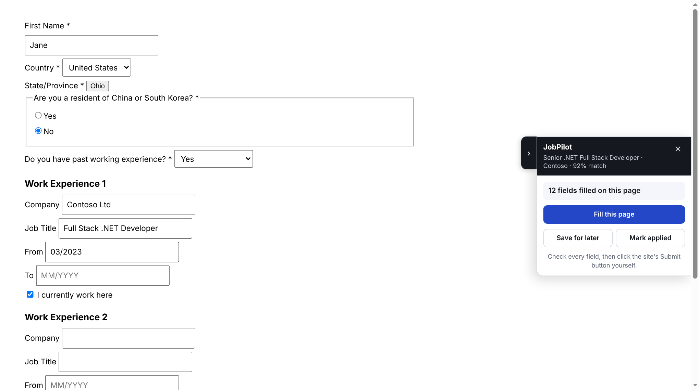
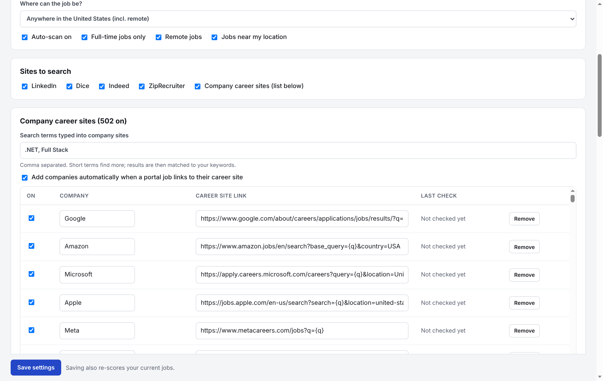
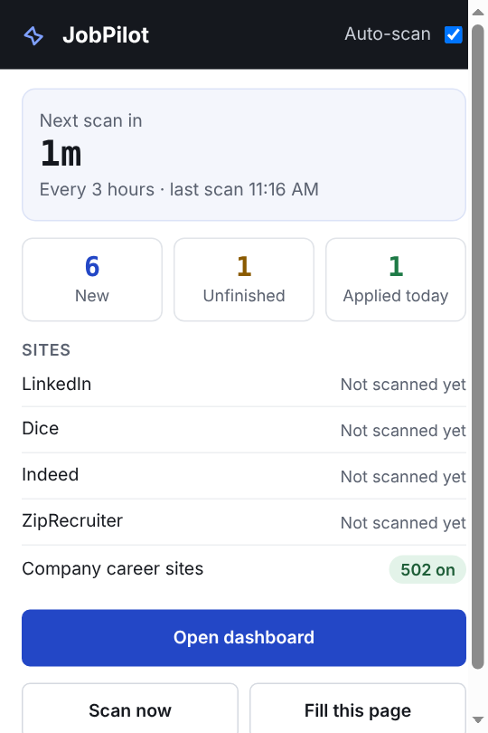

# JobPilot

**A Chrome extension that finds new jobs on company career sites and job portals every few hours, scores each one against your resume, filters out the ones you can't apply to, emails you the matches, and fills in the application for you to review and submit.**

I built this for my own job search as a .NET developer. Checking hundreds of career sites by hand every day wasn't realistic, and paid auto-apply tools either cost a monthly fee or submit applications without your review.



## What it does

| | |
|---|---|
| **Finds jobs** | Every few hours, it checks ~500 company career sites (Workday, Greenhouse, Lever, Ashby, SmartRecruiters, Amazon and custom pages), then LinkedIn, Dice, Indeed and ZipRecruiter. Only jobs posted in the last 24 hours are kept. |
| **Grows its own company list** | When a portal job links to a company's own career site, that company is added and checked directly from then on. Links that fail three scans in a row turn themselves off. |
| **Scores the match** | It compares each job description against your resume using ~90 editable skill groups, so "MS SQL", "SQL Server" and "T-SQL" count as the same skill. Required skills weigh more than "nice to have" ones. It shows which keywords you're missing. |
| **Filters** | It removes jobs that ask for citizenship or clearance, 10+ years, contract or part-time work, internships, or locations outside the US. All rules are editable phrases, with a "remove" or "flag only" option for each. |
| **Never shows a job twice** | It remembers every job by link and by company + title for 60 days, across sites and scans. |
| **Emails the matches** | One email per scan, company-site jobs first, sent through the user's own Gmail with a small Google Apps Script web app (free, nothing stored on a third-party server). |
| **Fills applications** | It fills text fields, dropdowns, custom dropdowns (Workday/React-style), radio and Yes/No questions, EEO questions, work history and education sections, and resume upload. The user always clicks Submit. |

## Screenshots

| Job details & skill gaps | Filling a company application |
|---|---|
|  |  |

| Settings | Toolbar popup |
|---|---|
|  |  |

*Screenshots use made-up sample companies and a demo profile.*

## How it works

```
 chrome.alarms (every N hours)
        │
        ▼
 background.js ── service worker ──────────────────────────────┐
   1. Company career sites   → job-feed APIs, 6 at a time      │
                               (Workday CXS, Greenhouse, Lever, │
                               Ashby, SmartRecruiters, Amazon)  │
                             → other pages: opened in a hidden  │
                               window and read                  │
   2. Job portals            → search pages opened in the same  │
                               hidden window, read by           │
                               shared/extractors.js             │
   3. Each new job           → description read, scored and     │
                               filtered (shared/match.js)       │
   4. commitJobs()           → adds only unseen jobs, never     │
                               overwrites user changes          │
   5. Gmail web app          → one email with all new matches   │
        │                                                       │
        ▼                                                       │
 chrome.storage.local  ◄── pages/dashboard (job queue, settings,│
                           profile, resume upload: pdf.js /     │
                           mammoth)                             │
        │                                                       │
        ▼                                                       │
 content/autofill.js  ── runs on application pages opened from  │
                         "Review & Submit"; fills each question │
                         once, never clicks Submit ◄────────────┘
```

### Engineering problems worth mentioning

- **Forms that fight back.** Many career sites are React or Angular apps that redraw fields after every change, or old ASP.NET WebForms pages that reload on change (`__doPostBack`). The filler sets values through the native value setters so frameworks notice them. It fills reload-prone fields without firing the events that reload the page. It also records each question it has answered, so a redrawn field is never filled, unticked or overwritten again. A loop guard pauses auto-fill only when a page reloads right after being filled.
- **Understanding what a field asks.** The filler reads labels, `aria-labelledby`, fieldset legends, nearby question text, and the section a field sits in. That way "Company" under *Work Experience 2* maps to your second job, not your current one, and a section you have no data for stays empty.
- **No lost data under concurrency.** Scans run for many minutes while the user is clicking Skip or Applied. All writes merge into the latest stored state instead of saving a stale copy, and a lock allows only one scan at a time.
- **Service worker lifetime.** Manifest V3 service workers can be stopped at any time. The scan window recreates itself if Chrome closes or discards it, and stale "scanning" flags are cleared on startup.
- **Free email without a backend.** A tiny Google Apps Script web app sends mail from the user's own Gmail. It checks a shared secret and only ever emails the account that owns it.

## Tech

JavaScript (ES modules), Chrome Extensions Manifest V3 (service worker, `chrome.scripting`, `chrome.alarms`, `chrome.storage`), Shadow DOM for the on-page panel, pdf.js and mammoth.js for reading resumes, Google Apps Script for email, `node:test` for unit tests, Playwright for end-to-end tests against practice career sites and application forms.

## Project layout

```
manifest.json         Extension manifest (MV3)
background.js         Scheduler, scanner, job storage, email, messages
content/autofill.js   Application form filler + side panel
shared/match.js       Skill extraction, scoring, filters, title matching, de-duplication
shared/sources.js     Job portal search URLs, career-site feed readers, location rules
shared/extractors.js  Functions injected into pages to read job lists and descriptions
shared/defaults.js    Default settings, filters, skill groups, company list
shared/store.js       Storage helpers, "already seen" memory, merge-safe saving
shared/ai.js          Optional AI resume tailoring (bring your own API key)
pages/                Dashboard and toolbar popup
tests/                Unit tests (npm test)
docs/                 User guide and screenshots
```

## Run it

1. Clone this repo.
2. Open `chrome://extensions`, turn on **Developer mode**, click **Load unpacked**, and choose the folder.
3. In the dashboard, upload a resume, fill in the profile and click **Scan now**.

Step-by-step setup, including email alerts and keeping the laptop awake: **[docs/USER_GUIDE.md](docs/USER_GUIDE.md)**.

```bash
npm test   # runs the unit tests (Node 18+)
```

## Responsible use

JobPilot only **prepares** applications: it never clicks Submit, never solves CAPTCHAs and never stores site passwords. It searches slowly, one page at a time with random pauses. LinkedIn is read through its public job listings, not a logged-in account. Respect each site's terms of use.

## License

MIT, © 2026 Nikitha Ravella. Bundled libraries: [pdf.js](https://github.com/mozilla/pdf.js) (Apache-2.0), [mammoth.js](https://github.com/mwilliamson/mammoth.js) (BSD-2-Clause).
